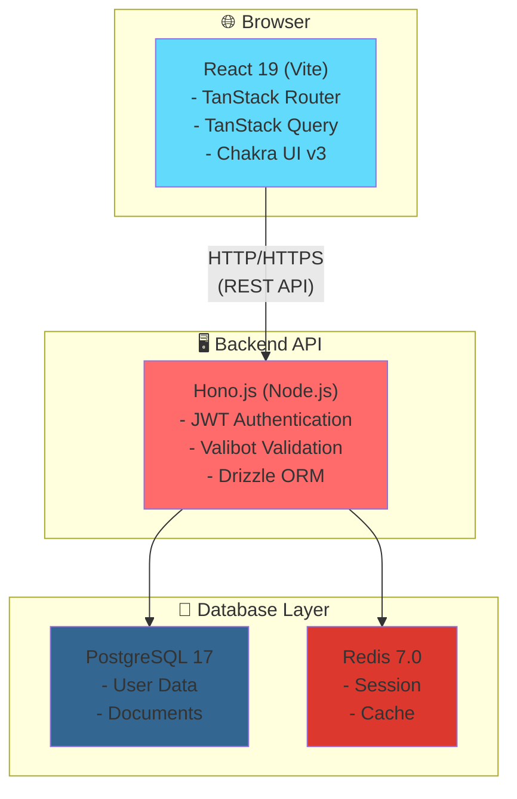
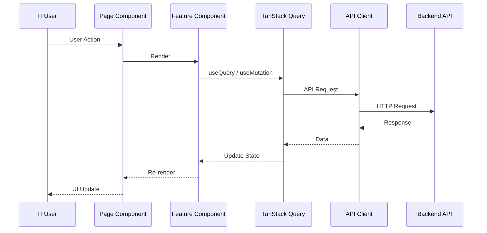

# アーキテクチャ概要

本ドキュメントでは、プロジェクト全体のアーキテクチャと設計方針について説明します。フロントエンドとバックエンドの構造、技術選定の理由、データフローなどを理解することで、効果的な開発が可能になります。

## 目次

[[toc]]

## システム構成

本プロジェクトは、モノレポ構成を採用したフルスタックアプリケーションです。



## モノレポ構成

### ディレクトリ構造

```
vite-hono-template/
├── apps/
│   ├── front/           # フロントエンドアプリケーション
│   └── main-api/        # バックエンド API
├── packages/
│   ├── domains/         # 共通ドメインモデル
│   └── biome-config/    # Biome 共通設定
├── db/                  # データベース初期化スクリプト
├── redis/               # Redis 設定
└── compose.yml          # Docker Compose 設定
```

### モノレポのメリット

1. **型定義の共有**: フロントエンドとバックエンドで同じ型を使用
2. **コードの再利用**: 共通のユーティリティやバリデーションロジックを共有
3. **一貫性**: 統一されたリンティング・フォーマット設定
4. **効率的な開発**: 1つのリポジトリで完結

## フロントエンドアーキテクチャ

### Feature Sliced Design

フロントエンドは **Feature Sliced Design** に基づいた構成になっています。

```
src/
├── app/              # アプリケーション全体の設定
│   ├── routes/       ... ルート定義
│   └── assets/       ... 静的ファイル
│
├── feature/          # 機能単位のコンポーネント
│   ├── document-form/
│   │   ├── document-form.tsx
│   │   ├── use-document-form.ts
│   │   └── index.ts
│   └── signup-form/
│
├── page/             # ページコンポーネント
│   ├── document-create/
│   │   ├── document-create-page.tsx
│   │   └── index.ts
│   └── sign-in/
│
├── widget/           # 複数ページで使用される大きなコンポーネント
│   └── layouts/
│       ├── main-layout.tsx
│       └── auth-layout.tsx
│
└── shared/           # プロジェクト全体で共有
    ├── api/          ... API クライアント
    ├── ui/           ... 共通 UI コンポーネント
    ├── lib/          ... ユーティリティ関数
    ├── config/       ... 設定ファイル
    └── provider/     ... Context Provider
```

### 各層の責務

#### app/

- アプリケーションのエントリーポイント
- ルーティング設定
- グローバルな Provider の配置

#### feature/

- 特定の機能に関連するコンポーネント群
- 他の feature に依存しない
- ビジネスロジックを含む

#### page/

- URL パスに対応するページコンポーネント
- feature や widget を組み合わせてページを構成
- TanStack Router の route として使用

#### widget/

- 複数のページで使用される大きなコンポーネント
- レイアウトコンポーネントなど

#### shared/

- プロジェクト全体で使用される汎用的なコード
- feature に依存しない

### データフロー


mermaid
graph TB
    subgraph Application["📱 Application Layer"]
        Router["Router"]
        Middleware["Middleware<br/>(Auth, Logging)"]
    end
    
    subgraph UseCase["💼 Use Case Layer"]
        CreateDoc["Create Document"]
        UpdateDoc["Update Document"]
        DeleteDoc["Delete Document"]
    end
    
    subgraph Repository["🗄️ Repository Layer"]
        DocRepo["Document Repository"]
        UserRepo["User Repository"]
    end
    
    subgraph Database["💾 Database"]
        PostgreSQL[(PostgreSQL)]
    end
    
    HTTP[HTTP Request] --> Router
    Router --> Middleware
    Middleware --> CreateDoc
    Middleware --> UpdateDoc
    Middleware --> DeleteDoc
    
    CreateDoc --> DocRepo
    UpdateDoc --> DocRepo
    DeleteDoc --> DocRepo
    CreateDoc --> UserRepo
    
    DocRepo --> PostgreSQL
    UserRepo --> PostgreSQL
    
    style Application fill:#e3f2fd
    style UseCase fill:#fff3e0
    style Repository fill:#f3e5f5
    style Database fill:#e8f5e9
```

**ディレクトリ構成**:

```
## バックエンドアーキテクチャ

### レイヤードアーキテクチャ

バックエンドは **レイヤードアーキテクチャ** を採用しています。

```
src/
├── apps/                 # アプリケーション層
│   ├── middleware/       ... ミドルウェア（認証、ロギングなど）
│   └── router/           ... ルーティング定義
│
├── usecases/             # ユースケース層（ビジネスロジック）
│   ├── document/
│   │   ├── create-document.usecase.ts
│   │   ├── update-document.usecase.ts
│   │   └── delete-document.usecase.ts
│   └── user/
│
├── repositories/         # リポジトリ層（データアクセス）
│   ├── document.repository.ts
│   └── user.repository.ts
│
├── libs/                 # ライブラリ層
│   ├── configs/          ... 設定ファイル
│   └── utils/            ... ユーティリティ関数
│
└── index.ts              # エントリーポイント
```

### 各層の責務

#### アプリケーション層 (apps/)

**責務**:

- HTTP リクエストの受付とレスポンスの返却
- リクエストのバリデーション（Valibot）
- 認証・認可の確認
- ユースケース層への処理の委譲

**例**:

```typescript
// apps/router/document.router.ts
import { Hono } from 'hono';
import { vValidator } from '@hono/valibot-validator';
import { createDocumentSchema } from '@repo/domains';

const app = new Hono();

app.post('/documents', vValidator('json', createDocumentSchema), async (c) => {
  const body = c.req.valid('json');
  const userId = c.get('userId'); // ミドルウェアで設定

  const result = await createDocumentUseCase(userId, body);

  if (result.isErr()) {
    return c.json({ error: result.error }, 400);
  }

  return c.json(result.value, 201);
});
```

#### ユースケース層 (usecases/)

**責務**:

- ビジネスロジックの実装
- トランザクション管理
- リポジトリを使用したデータ操作
- Result 型を使用したエラーハンドリング

**例**:

```typescript
// usecases/document/create-document.usecase.ts
import { ok, err, Result } from 'neverthrow';
import type { DocumentRepository } from '@/repositories/document.repository';
import type { CreateDocumentDto } from '@repo/domains';

export type CreateDocumentUseCase = (
  userId: string,
  dto: CreateDocumentDto
) => Promise<Result<Document, Error>>;

export function createDocumentUseCase(
  documentRepository: DocumentRepository
): CreateDocumentUseCase {
  return async (userId, dto) => {
    try {
      const document = await documentRepository.create({
        ...dto,
        userId,
      });

      return ok(document);
    } catch (error) {
      return err(new Error('Failed to create document'));
    }
  };
}
```

#### リポジトリ層 (repositories/)

**責務**:

- データベースとの連携
- Dmermaid
flowchart TD
    Request[HTTP Request] --> Router["Router<br/>(apps/router)"]
    Router --> Middleware["Middleware<br/>(認証・バリデーション)"]
    Middleware --> UseCase["Use Case<br/>(usecases/)"]
    UseCase --> Repository["Repository<br/>(repositories/)"]
    Repository --> Database[(PostgreSQL)]
    Database --> Repository
    Repository --> UseCase
    UseCase --> Middleware
    Middleware --> Router
    Router --> Response[HTTP Response]
    
    style Request fill:#e3f2fd
    style Router fill:#fff3e0
    style Middleware fill:#f3e5f5
    style UseCase fill:#e8f5e9
    style Repository fill:#fce4ec
    style Database fill:#ffebee
    style Response fill:#e0f2f1ocument) => Promise<Document>;
  findById: (id: string) => Promise<Document | null>;
  update: (id: string, data: Partial<Document>) => Promise<Document>;
  delete: (id: string) => Promise<void>;
};

export function createDocumentRepository(
  database = db
): DocumentRepository {
  return {
    async create(data) {
      const [document] = await database
        .insert(documents)
        .values(data)
        .returning();
      return document;
    },

    async findById(id) {
      const [document] = await database
        .select()
        .from(documents)
        .where(eq(documents.id, id));
      return document ?? null;
    },

    // ...
  };
}
```

### データフロー

```
HTTP Request
    ↓
Router (apps/router)
    ↓
Middleware (認証・バリデーション)
    ↓
Use Case (usecases/)
    ↓
Repository (repositories/)
    ↓
Database (PostgreSQL)
```

## 共通パッケージ

### @repo/domains

フロントエンドとバックエンドで共有する型定義とバリデーションスキーマを管理します。

```typescript
// packages/domains/src/dto/document.dto.ts
import * as v from 'valibot';

export const createDocumentSchema = v.object({
  title: v.string([v.minLength(1, 'タイトルは必須です')]),
  content: v.string([v.minLength(1, '本文は必須です')]),
});

export type CreateDocumentDto = v.InferOutput<typeof createDocumentSchema>;
```

**メリット**:

- 型定義の一元管理
- フロントエンドとバックエンドで同じバリデーションロジック
- 型安全性の向上

### @repo/biome-config

Biome の共通設定を管理します。

```json
// packages/biome-config/biome.json
{
  "formatter": {
    "enabled": true,
    "indentStyle": "tab"
  },
  "linter": {
    "enabled": true,
    "rules": {
      "recommended": true
    }
  }
}
```

## 依存関係の注入（DI）

ユースケースやリポジトリは、依存関係を外部から注入する設計になっています。

### メリット

1. **テスタビリティ**: モックに差し替えやすい
2. **柔軟性**: 実装を簡単に切り替えられる
3. **疎結合**: 各層が独立している

### 実装例

```typescript
// mermaid
sequenceDiagram
    participant User as 👤 User
    participant Frontend as Frontend
    participant Supabase as Supabase Auth
    participant Backend as Backend API
    participant DB as Database
    
    User->>Frontend: 1. ログイン
    Frontend->>Supabase: 2. 認証リクエスト
    Supabase-->>Frontend: 3. JWT トークン発行
    Frontend->>Frontend: 4. Cookie に保存
    
    User->>Frontend: 5. API リクエスト
    Frontend->>Backend: 6. トークン付きリクエスト
    Backend->>Backend: 7. トークン検証
    
    alt 認証成功
        Backend->>DB: 8. データ取得
        DB-->>Backend: データ
        Backend-->>Frontend: 9. レスポンス
        Frontend-->>User: 結果表示
    else 認証失敗
        Backend-->>Frontend: 401 Unauthorized
        Frontend-->>User: エラー表示
    en
      documentRepository,
    },
  };
}
```

## トランザクション管理

データベースのトランザクションは、ユースケース層で管理します。

詳細は [トランザクション処理パターン](../../../apps/main-api/docs/transaction-pattern.md) を参照してください。

**基本パターン**:

```typescript
export function createDocumentWithTagsUseCase(
  documentRepository: DocumentRepository,
  tagRepository: TagRepository
) {
  return async (userId: string, dto: CreateDocumentWithTagsDto) => {
    return await db.transaction(async (trx) => {
      // トランザクション内で複数の操作を実行
      const document = await documentRepository.create(trx, {
        ...dto,
        userId,
      });

      await tagRepository.createMany(trx, dto.tags);

      return ok(document);
    });
  };
}
```

## 認証・認可

### 認証フロー

```
1. ユーザーがログイン
    ↓
2. Supabase が JWT トークンを発行
    ↓
3. フロントエンドがトークンを Cookie に保存
    ↓
4. API リクエスト時にトークンを送信
    ↓
5. バックエンドがトークンを検証
    ↓
6. 認証成功 → リクエスト処理
   認証失敗 → 401 Unauthorized
```

詳細は [認証機能実装ガイド](../rules/authentication.md) を参照してください。

## エラーハンドリング

### Result 型

バックエンドでは `neverthrow` の Result 型を使用してエラーを表現します。

```typescript
import { ok, err, Result } from 'neverthrow';

function divide(a: number, b: number): Result<number, string> {
  if (b === 0) {
    return err('Division by zero');
  }
  return ok(a / b);
}

const result = divide(10, 2);
if (result.isOk()) {
  console.log(result.value); // 5
} else {
  console.log(result.error); // エラーメッセージ
}
```

### カスタムエラー

```typescript
export class NotFoundError extends Error {
  constructor(
    public resource: string,
    public id: string
  ) {
    super(`${resource} with id ${id} not found`);
    this.name = 'NotFoundError';
  }
}
```

## パフォーマンス最適化

### フロントエンド

- **React のメモ化**: `React.memo`, `useMemo`, `useCallback`
- **コード分割**: Dynamic Import
- **TanStack Query のキャッシュ**: staleTime, cacheTime の適切な設定

### バックエンド

- **データベースクエリ最適化**: N+1 問題の回避
- **インデックスの活用**: 適切なインデックスを設定
- **Redis キャッシュ**: 頻繁にアクセスされるデータをキャッシュ

## スケーラビリティ

### 水平スケーリング

- API サーバーはステートレスに設計
- セッションは Redis で管理
- データベースは PostgreSQL のレプリケーション機能を活用

### 垂直スケーリング

- Docker Compose でリソース制限を設定
- 本番環境では適切なインスタンスサイズを選択

## まとめ

本プロジェクトは、モノレポ構成を活かした型安全なフルスタックアプリケーションです。

- **フロントエンド**: Feature Sliced Design
- **バックエンド**: レイヤードアーキテクチャ
- **共通**: 型定義の共有、依存関係の注入

このアーキテクチャに従うことで、保守性が高く、拡張しやすいシステムを構築できます！
