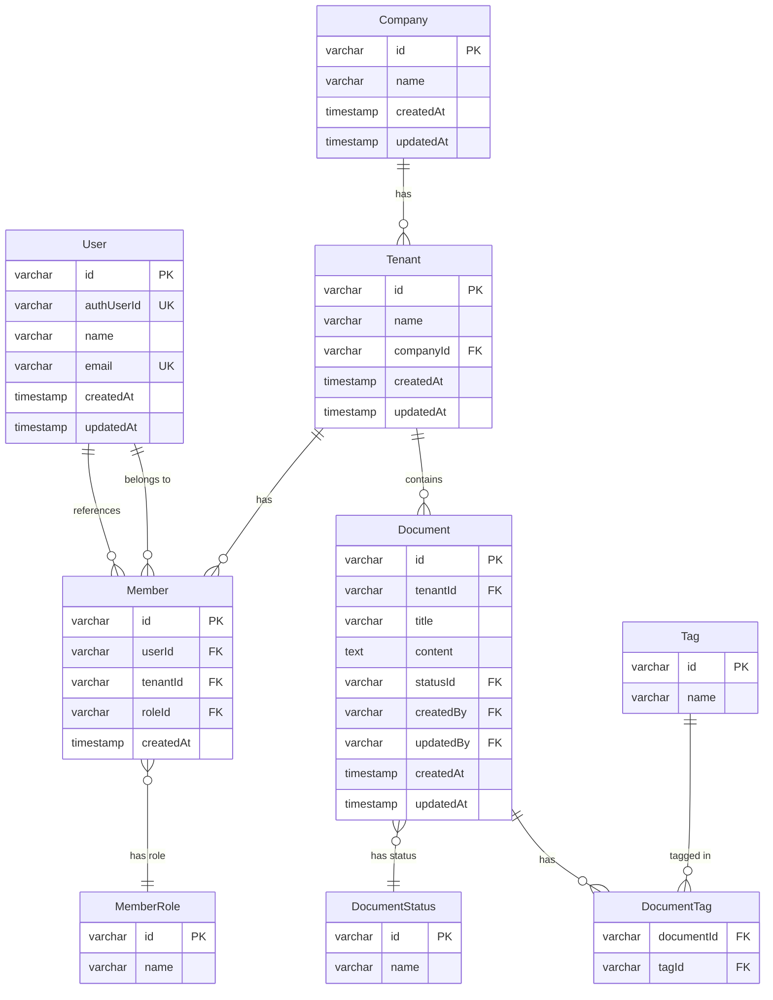
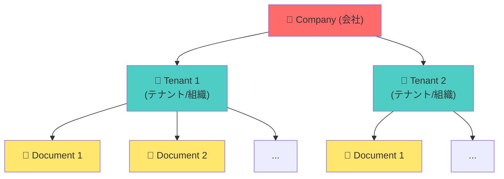

# データベース設計

本ドキュメントでは、プロジェクトのデータベース設計について説明します。スキーマ定義、リレーション、マイグレーション管理、ベストプラクティスをまとめています。

## 目次

<details>
  <summary>目次一覧</summary>

[[toc]]
</details>

## 概要

### 使用技術

- **データベース**: PostgreSQL 17
- **ORM**: Drizzle ORM
- **マイグレーション**: Drizzle Kit
- **スキーマ管理**: TypeScript による型安全なスキーマ定義

### ディレクトリ構成

```
apps/main-api/drizzle/
├── base/              # テーブル定義
│   ├── user.schema.ts
│   ├── document.schema.ts
│   ├── tenant.schema.ts
│   └── ...
├── relations/         # テーブル間のリレーション定義
│   ├── user.relation.ts
│   └── ...
├── types/             # 型定義
│   ├── user.type.ts
│   └── ...
├── migrations/        # マイグレーションファイル（自動生成）
├── schema.ts          # すべてのスキーマをエクスポート
├── index.ts           # Drizzle ORM のセットアップ
├── seed.ts            # シードデータ
└── reset.ts           # データベースリセット
```

## データモデル

### エンティティ関係図（ER図）



### マルチテナントアーキテクチャ

本プロジェクトは、**マルチテナントアーキテクチャ** を採用しています。



**特徴**:

- 1つの Company が複数の Tenant を持つ
- データは Tenant ごとに分離される
- ユーザーは複数の Tenant にアクセス可能（Member として登録）

## テーブル定義

### User テーブル

ユーザーの基本情報を管理します。

```typescript
// apps/main-api/drizzle/base/user.schema.ts
export const userDbSchema = pgTable('user', {
  id: varchar({ length: 256 }).primaryKey().notNull().unique().$defaultFn(uuid),
  authUserId: varchar('auth_user_id', { length: 256 }).notNull().unique(),
  name: varchar({ length: 256 }).notNull(),
  email: varchar({ length: 256 }).notNull().unique(),
  createdAt: timestamp('created_at').defaultNow().notNull(),
  updatedAt: timestamp('updated_at')
    .defaultNow()
    .$onUpdateFn(() => new Date())
    .notNull(),
  createdBy: varchar('created_by', { length: 256 }).notNull(),
  updatedBy: varchar('updated_by', { length: 256 }).notNull(),
});
```

**カラム説明**:

| カラム名     | 型          | 説明                                    |
| ------------ | ----------- | --------------------------------------- |
| `id`         | varchar     | 内部 ID（UUID v7）                      |
| `authUserId` | varchar     | Supabase の認証 ID                      |
| `name`       | varchar     | ユーザー名                              |
| `email`      | varchar     | メールアドレス（ユニーク）              |
| `createdAt`  | timestamp   | 作成日時                                |
| `updatedAt`  | timestamp   | 更新日時（自動更新）                    |
| `createdBy`  | varchar     | 作成者 ID                               |
| `updatedBy`  | varchar     | 更新者 ID                               |

### Document テーブル

ドキュメントを管理します。

```typescript
// apps/main-api/drizzle/base/document.schema.ts
export const documentDbSchema = pgTable('document', {
  id: varchar({ length: 256 }).primaryKey().$defaultFn(uuid).notNull().unique(),
  tenantId: varchar('tenant_id', { length: 256 })
    .notNull()
    .references(() => tenantDbSchema.id),
  title: varchar({ length: 256 }).notNull(),
  description: text(),
  content: text(),
  statusId: varchar('status_id', { length: 256 })
    .notNull()
    .references(() => documentStatusDbSchema.id),
  createdAt: timestamp('created_at').defaultNow().notNull(),
  updatedAt: timestamp('updated_at')
    .defaultNow()
    .$onUpdate(() => new Date())
    .notNull(),
  createdBy: varchar('created_by', { length: 256 }).notNull(),
  updatedBy: varchar('updated_by', { length: 256 }).notNull(),
});
```

**カラム説明**:

| カラム名      | 型        | 説明                          |
| ------------- | --------- | ----------------------------- |
| `id`          | varchar   | ドキュメント ID（UUID v7）    |
| `tenantId`    | varchar   | テナント ID（外部キー）       |
| `title`       | varchar   | タイトル                      |
| `description` | text      | 説明                          |
| `content`     | text      | 本文                          |
| `statusId`    | varchar   | ステータス ID（外部キー）     |
| `createdAt`   | timestamp | 作成日時                      |
| `updatedAt`   | timestamp | 更新日時                      |
| `createdBy`   | varchar   | 作成者 ID                     |
| `updatedBy`   | varchar   | 更新者 ID                     |

### Tenant テーブル

テナント（組織）を管理します。

```typescript
export const tenantDbSchema = pgTable('tenant', {
  id: varchar({ length: 256 }).primaryKey().$defaultFn(uuid).notNull().unique(),
  name: varchar({ length: 256 }).notNull(),
  companyId: varchar('company_id', { length: 256 })
    .notNull()
    .references(() => companyDbSchema.id),
  createdAt: timestamp('created_at').defaultNow().notNull(),
  updatedAt: timestamp('updated_at')
    .defaultNow()
    .$onUpdate(() => new Date())
    .notNull(),
  createdBy: varchar('created_by', { length: 256 }).notNull(),
  updatedBy: varchar('updated_by', { length: 256 }).notNull(),
});
```

### Company テーブル

会社を管理します。

```typescript
export const companyDbSchema = pgTable('company', {
  id: varchar({ length: 256 }).primaryKey().$defaultFn(uuid).notNull().unique(),
  name: varchar({ length: 256 }).notNull(),
  createdAt: timestamp('created_at').defaultNow().notNull(),
  updatedAt: timestamp('updated_at')
    .defaultNow()
    .$onUpdate(() => new Date())
    .notNull(),
  createdBy: varchar('created_by', { length: 256 }).notNull(),
  updatedBy: varchar('updated_by', { length: 256 }).notNull(),
});
```

## リレーション定義

Drizzle ORM のリレーション機能を使用して、テーブル間の関係を定義します。

```typescript
// apps/main-api/drizzle/relations/document.relation.ts
import { relations } from 'drizzle-orm';
import { documentDbSchema } from '../base/document.schema';
import { tenantDbSchema } from '../base/tenant.schema';
import { documentStatusDbSchema } from '../base/document-status.schema';

export const documentRelations = relations(documentDbSchema, ({ one }) => ({
  tenant: one(tenantDbSchema, {
    fields: [documentDbSchema.tenantId],
    references: [tenantDbSchema.id],
  }),
  status: one(documentStatusDbSchema, {
    fields: [documentDbSchema.statusId],
    references: [documentStatusDbSchema.id],
  }),
}));
```

**メリット**:

- 型安全な JOIN クエリ
- リレーションを明示的に定義
- IDE の補完が効く

## 命名規則

### テーブル名

- **単数形**: `user`, `document`, `tenant`（複数形は使用しない）
- **スネークケース**: 複合語は `document_status`, `member_role`

### カラム名

- **キャメルケース（TypeScript）**: `createdAt`, `updatedAt`
- **スネークケース（SQL）**: `created_at`, `updated_at`（Drizzle が自動変換）

### 外部キー

- **〇〇Id**: `tenantId`, `companyId`, `statusId`

### 論理削除カラム

- **deletedAt**: `timestamp` 型、削除日時を記録
- 削除済みテーブル: `user_deleted`, `tenant_deleted`

## 共通カラム

すべてのテーブルに以下の共通カラムを持たせます:

| カラム名    | 型        | 説明         |
| ----------- | --------- | ------------ |
| `id`        | varchar   | 主キー       |
| `createdAt` | timestamp | 作成日時     |
| `updatedAt` | timestamp | 更新日時     |
| `createdBy` | varchar   | 作成者 ID    |
| `updatedBy` | varchar   | 更新者 ID    |

## マイグレーション管理

### マイグレーションの生成

スキーマを変更した後、マイグレーションファイルを生成します。

```bash
cd apps/main-api
pnpm drizzle:generate
```

生成されたマイグレーションファイル:

```sql
-- drizzle/migrations/0000_famous_warpath.sql
CREATE TABLE "user" (
  "id" varchar(256) PRIMARY KEY NOT NULL UNIQUE,
  "auth_user_id" varchar(256) NOT NULL UNIQUE,
  "name" varchar(256) NOT NULL,
  "email" varchar(256) NOT NULL UNIQUE,
  "created_at" timestamp DEFAULT now() NOT NULL,
  "updated_at" timestamp DEFAULT now() NOT NULL,
  "created_by" varchar(256) NOT NULL,
  "updated_by" varchar(256) NOT NULL
);
```

### マイグレーションの適用

```bash
cd apps/main-api
pnpm drizzle:migrate
```

### マイグレーションの確認

```bash
cd apps/main-api
pnpm drizzle:studio
```

ブラウザで https://local.drizzle.studio が開き、GUI でデータベースを確認できます。

## インデックス設計

### 基本方針

1. **主キー**: 自動的にインデックスが作成される
2. **外部キー**: 検索に使用する場合はインデックスを追加
3. **検索条件**: WHERE 句で頻繁に使用するカラムにインデックスを追加
4. **ユニーク制約**: 自動的にインデックスが作成される

### インデックスの追加例

```typescript
import { index } from 'drizzle-orm/pg-core';

export const documentDbSchema = pgTable(
  'document',
  {
    id: varchar({ length: 256 }).primaryKey(),
    tenantId: varchar('tenant_id', { length: 256 }).notNull(),
    title: varchar({ length: 256 }).notNull(),
    // ...
  },
  (table) => ({
    tenantIdIdx: index('document_tenant_id_idx').on(table.tenantId),
    titleIdx: index('document_title_idx').on(table.title),
  })
);
```

## データ整合性

### 外部キー制約

外部キー制約を使用して、データの整合性を保ちます。

```typescript
tenantId: varchar('tenant_id', { length: 256 })
  .notNull()
  .references(() => tenantDbSchema.id, { onDelete: 'cascade' }),
```

**オプション**:

- `onDelete: 'cascade'`: 親レコードが削除されたら子レコードも削除
- `onDelete: 'set null'`: 親レコードが削除されたら NULL に設定
- `onDelete: 'restrict'`: 子レコードが存在する場合、親レコードの削除を拒否

### NOT NULL 制約

必須カラムには `notNull()` を使用します。

```typescript
name: varchar({ length: 256 }).notNull(),
```

### UNIQUE 制約

一意性を保証するカラムには `unique()` を使用します。

```typescript
email: varchar({ length: 256 }).notNull().unique(),
```

## 論理削除

物理削除ではなく、論理削除を採用します。

### 論理削除の実装

```typescript
export const userDbSchema = pgTable('user', {
  // ...
  deletedAt: timestamp('deleted_at'),
});
```

削除処理:

```typescript
// 論理削除
await db
  .update(userDbSchema)
  .set({ deletedAt: new Date() })
  .where(eq(userDbSchema.id, userId));

// 取得時は deletedAt が NULL のレコードのみ
await db
  .select()
  .from(userDbSchema)
  .where(isNull(userDbSchema.deletedAt));
```

### 削除済みデータの保管

削除されたデータは別テーブルに移動します。

```typescript
// user_deleted テーブル
export const userDeletedDbSchema = pgTable('user_deleted', {
  // user テーブルと同じスキーマ
  // ...
  deletedAt: timestamp('deleted_at').notNull(),
});
```

## UUIDv7 の使用

主キーには **UUIDv7** を使用します。

**メリット**:

- タイムスタンプベースでソート可能
- 分散システムでの一意性
- セキュリティ（連番ではないため推測されにくい）

```typescript
import { v7 as uuid } from 'uuid';

id: varchar({ length: 256 }).primaryKey().$defaultFn(uuid).notNull().unique(),
```

## トランザクション

複数のテーブルを更新する場合は、トランザクションを使用します。

```typescript
await db.transaction(async (trx) => {
  const document = await trx.insert(documentDbSchema).values({
    tenantId,
    title,
    content,
  });

  await trx.insert(documentTagDbSchema).values({
    documentId: document.id,
    tagId,
  });
});
```

詳細は [トランザクション処理パターン](../../../apps/main-api/docs/transaction-pattern.md) を参照してください。

## シードデータ

開発環境やテスト環境で使用するシードデータを定義します。

```typescript
// apps/main-api/drizzle/seed.ts
import { db } from './index';
import { userDbSchema } from './base/user.schema';

export async function seed() {
  await db.insert(userDbSchema).values([
    {
      authUserId: 'test-user-1',
      name: 'Test User 1',
      email: 'test1@example.com',
    },
    {
      authUserId: 'test-user-2',
      name: 'Test User 2',
      email: 'test2@example.com',
    },
  ]);
}
```

### シードデータの投入

```bash
cd apps/main-api
pnpm drizzle:seed
```

## ベストプラクティス

### 1. マイグレーションは小さく保つ

1つのマイグレーションで大きな変更を行わず、小さな変更に分割します。

### 2. ロールバックを考慮

マイグレーションは元に戻せるように設計します。

### 3. 本番環境での慎重な実行

本番環境でのマイグレーションは、必ずバックアップを取ってから実行します。

### 4. インデックスは必要最小限に

インデックスは検索を高速化しますが、挿入・更新を遅くするため、必要最小限に留めます。

### 5. NULL を避ける

可能な限り NOT NULL 制約を使用し、デフォルト値を設定します。

### 6. 適切なデータ型を選択

- 文字列の長さ制限: `varchar(256)` など適切な長さを設定
- 日時: `timestamp` を使用
- 真偽値: `boolean` を使用

## データベースリセット

開発環境でデータベースを初期状態に戻す場合:

```bash
cd apps/main-api
pnpm drizzle:reset
```

**注意**: すべてのデータが削除されます！

## まとめ

本プロジェクトのデータベース設計は、以下の原則に基づいています:

- **型安全**: Drizzle ORM による TypeScript 型定義
- **マルチテナント**: Company → Tenant → Document の階層構造
- **整合性**: 外部キー制約による参照整合性
- **拡張性**: スキーマの変更がマイグレーションで管理される
- **保守性**: 命名規則の統一、共通カラムの使用

データベース設計の変更は慎重に行い、必ずマイグレーションを通じて管理しましょう！
