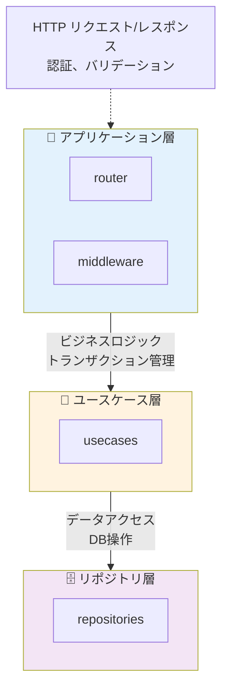

# アプリケーション設計

本プロジェクトの設計方針とアーキテクチャについてのドキュメント集です。システム全体の構造から、個別のコンポーネント設計まで、開発の指針となる情報をまとめています。

## 目次

### アーキテクチャ

- [アーキテクチャ概要](./architecture.md) - システム全体のアーキテクチャと設計方針
- [データベース設計](./database.md) - データベーススキーマ、リレーション、設計パターン
- [API 設計ガイドライン](./api-design.md) - REST API の設計原則とベストプラクティス

## 設計原則

本プロジェクトでは以下の設計原則に基づいて開発を行います:

### 1. レイヤードアーキテクチャ（バックエンド）

バックエンドは以下の層に分割されています:



各層は明確な責務を持ち、疎結合を保ちます。

### 2. Feature Sliced Design（フロントエンド）

フロントエンドは以下の構造で整理されています:

```
app/        ← アプリケーション全体の設定
  ├── routes/       ... ルート定義
  └── assets/       ... 画像、フォントなど

feature/    ← 機能単位のコンポーネント
  ├── document-form/
  └── signup-form/

page/       ← ページコンポーネント
  ├── document-create/
  ├── document-edit/
  └── sign-in/

widget/     ← 複数ページで使用される大きなコンポーネント
  └── layouts/

shared/     ← プロジェクト全体で共有
  ├── api/          ... API クライアント
  ├── ui/           ... 共通 UI コンポーネント
  ├── lib/          ... ユーティリティ関数
  └── config/       ... 設定ファイル
```

### 3. 型安全性

- TypeScript の型システムを最大限活用
- フロントエンドとバックエンドで型定義を共有（`@repo/domains`）
- Valibot を使用したランタイムバリデーション

### 4. 単一責任の原則（SRP）

- 各モジュール、関数、コンポーネントは1つの責務のみを持つ
- 関数は小さく保ち、テストしやすい構造にする
- 複雑なロジックは適切に分割する

### 5. 依存性注入（DI）

- ビジネスロジックはデータアクセス層に直接依存しない
- リポジトリやサービスは外部から注入する
- テスタビリティと拡張性を確保

### 6. エラーハンドリング

- Result 型を使用した明示的なエラー処理（バックエンド）
- 適切なHTTPステータスコードの返却
- ユーザーフレンドリーなエラーメッセージ

## 共通パターン

### トランザクション管理

データベースのトランザクションは、ユースケース層で管理します。

詳細は [apps/main-api/docs/transaction-pattern.md](../../../apps/main-api/docs/transaction-pattern.md) を参照してください。

### 認証・認可

Supabase を使用した JWT ベースの認証を採用しています。

詳細は [認証機能実装ガイド](../rules/authentication.md) を参照してください。

### データフェッチング

フロントエンドでは TanStack Query を使用してサーバー状態を管理します。

```typescript
import { useQuery } from '@tanstack/react-query';
import { api } from '@/shared/api';

export function useDocument(id: string) {
  return useQuery({
    queryKey: ['document', id],
    queryFn: () => api.documents.get(id),
  });
}
```

### フォーム管理

React Hook Form と Valibot を組み合わせて使用します。

```typescript
import { useForm } from 'react-hook-form';
import { valibotResolver } from '@hookform/resolvers/valibot';
import * as v from 'valibot';

const schema = v.object({
  title: v.string([v.minLength(1, 'タイトルは必須です')]),
  content: v.string([v.minLength(1, '本文は必須です')]),
});

export function DocumentForm() {
  const { register, handleSubmit } = useForm({
    resolver: valibotResolver(schema),
  });

  // ...
}
```

## パフォーマンス最適化

### フロントエンド

- コンポーネントの適切なメモ化（`React.memo`, `useMemo`, `useCallback`）
- TanStack Query のキャッシュ戦略
- 画像の最適化（Next.js Image コンポーネント相当の実装）

### バックエンド

- データベースクエリの最適化（N+1問題の回避）
- 適切なインデックスの設定
- Redis を使用したキャッシュ

## セキュリティ

### 入力のバリデーション

- すべてのユーザー入力は Valibot でバリデーション
- SQL インジェクション対策（Drizzle ORM のプリペアドステートメント）
- XSS 対策（React の自動エスケープ）

### 認証・認可

- JWT トークンの検証
- RBAC（ロールベースアクセス制御）の実装
- CSRF 対策

### データ保護

- 環境変数で機密情報を管理
- センシティブな情報をログに出力しない
- HTTPS 通信の強制（本番環境）

## テスト戦略

### ユニットテスト

- Vitest を使用
- 重要なビジネスロジックは必ずテスト
- カバレッジ目標: 70% 以上

### 統合テスト

- API エンドポイントのテスト
- データベースとの連携テスト

### E2E テスト

- 重要なユーザーフローをカバー
- Playwright などのツールを使用（今後導入予定）

## ドキュメント管理

### コードコメント

- JSDoc を使用して関数やコンポーネントを文書化
- 複雑なロジックには詳細なコメントを追加
- 「なぜ」を説明する（「何を」はコードから読み取れる）

### ドキュメント

- VitePress を使用してプロジェクトドキュメントを管理
- 設計変更時にはドキュメントも更新
- README を常に最新の状態に保つ

## 今後の拡張

- マイクロサービス化の検討
- GraphQL の導入検討
- リアルタイム機能の実装（WebSocket）
- モバイルアプリの開発（React Native）

## 参考資料

- [Feature Sliced Design](https://feature-sliced.design/)
- [Clean Architecture](https://blog.cleancoder.com/uncle-bob/2012/08/13/the-clean-architecture.html)
- [React Best Practices](https://react.dev/learn)
- [Hono.js Documentation](https://hono.dev/)

---

設計に関する質問や提案があれば、遠慮なくチームメンバーに共有してください！
