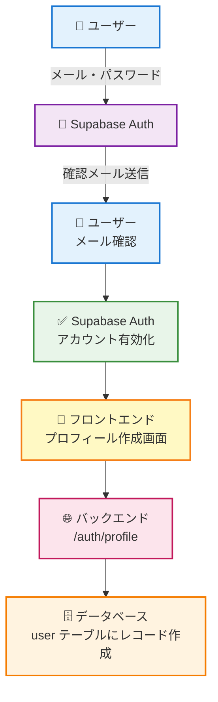
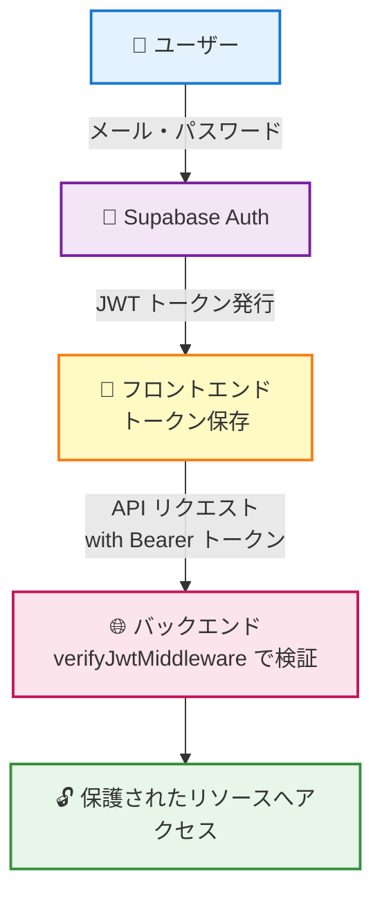

# Supabase 認証機能の実装ガイド

## 📖 概要

このプロジェクトでは、**Supabase** を使用した認証・認可機能を実装しています。
Supabase は、PostgreSQL ベースの BaaS (Backend as a Service) で、認証機能を簡単に統合できます。

## 🏗️ アーキテクチャ

### フロントエンド

- **認証クライアント**: `@supabase/supabase-js` を使用
- **状態管理**: カスタムフック `useAuth()` で認証状態を管理
- **ルート保護**: TanStack Router の `beforeLoad` で認証ガード

### バックエンド

- **JWT 検証**: Supabase が発行する JWT トークンを検証
- **ミドルウェア**: `verifyJwtMiddleware` で保護されたエンドポイントを管理
- **ユーザー管理**: `authUserId` と内部 `id` を紐づけ

## 🚀 セットアップ手順

### 1. Supabase プロジェクトの作成

1. [Supabase](https://supabase.com/) にアクセス
2. 新規プロジェクトを作成
3. プロジェクトの設定から以下の情報を取得:
   - Project URL
   - Anon Key
   - JWT Secret

### 2. 環境変数の設定

#### フロントエンド (`apps/front/.env.local`)

```env
VITE_SUPABASE_URL=https://your-project.supabase.co
VITE_SUPABASE_ANON_KEY=your-anon-key
```

#### バックエンド (`apps/main-api/.env`)

```env
SUPABASE_URL=https://your-project.supabase.co
SUPABASE_ANON_KEY=your-anon-key
SUPABASE_JWT_SECRET=your-jwt-secret

# （任意）本番環境などで main-api の公開URLが推測できない場合に設定
API_ORIGIN=https://api.example.com
```

### 3. 必要なパッケージのインストール

```bash
# ルートディレクトリで実行
pnpm install

# または、個別にインストール
cd apps/front
pnpm add @supabase/supabase-js

cd ../main-api
pnpm add @supabase/supabase-js jose
```

## 📚 使い方

## 🔁 OAuth（PKCE）フロー（main-api で実行）

このテンプレートでは、**OAuth の PKCE（Authorization Code + S256）** フローは `apps/main-api` が担当します。

- 開始: `GET /auth/login?provider=google&returnTo=/`
- コールバック: `GET /auth/callback`（Supabase がここへリダイレクト）

`/auth/callback` はトークン交換を行い、`sb-access-token` / `sb-refresh-token` を **HttpOnly Cookie** として発行した後、フロントへ戻します。

### フロントエンド

#### 認証状態の取得

```tsx
import { useAuth } from '@/shared/lib/use-auth';

function MyComponent() {
	const { user, loading, signIn, signOut } = useAuth();

	if (loading) {
		return <div>読み込み中...</div>;
	}

	if (!user) {
		return (
			<button onClick={() => signIn('email@example.com', 'password')}>
				ログイン
			</button>
		);
	}

	return (
		<div>
			<p>ようこそ、{user.email}さん!</p>
			<button onClick={signOut}>ログアウト</button>
		</div>
	);
}
```

#### 保護されたルートの作成

`(authenticated)` ディレクトリ内にルートを作成すると、自動的に認証が必要になります。

```
src/app/routes/
  (authenticated)/
    _authenticated.tsx  # 認証ガード
    dashboard.tsx       # 保護されたページ
    profile.tsx         # 保護されたページ
```

### バックエンド

#### 保護されたエンドポイントの作成

```typescript
import { Hono } from 'hono';
import { verifyJwtMiddleware } from './middleware/auth';

const protectedRouter = new Hono();

// 認証ミドルウェアを適用
protectedRouter.use('*', verifyJwtMiddleware);

// 認証が必要なエンドポイント
protectedRouter.get('/data', async (c) => {
	// コンテキストから認証済みユーザーIDを取得
	const authUserId = c.req.header('authUserId');
	const email = c.req.header('userEmail');

	return c.json({
		message: 'これは保護されたデータです',
		authUserId,
		email
	});
});

export { protectedRouter };
```

#### ユーザー情報の取得

```typescript
// authUserId からユーザー情報を取得
const result = await repository.user.findByAuthUserId(authUserId);

if (result.isOk()) {
	const user = result.value;
	console.log(user.id, user.name, user.email);
}
```

## 🔐 セキュリティのベストプラクティス

### 1. Row Level Security (RLS) の設定

Supabase の PostgreSQL では、RLS を使用してデータアクセスを制御できます。

```sql
-- ユーザーは自分のデータのみアクセス可能
CREATE POLICY "Users can only access their own data"
ON public.user
FOR ALL
USING (auth.uid() = auth_user_id);
```

### 2. JWT トークンの扱い

- トークンは **Authorization ヘッダー** に `Bearer` 形式で送信
- フロントエンドでは自動的に Supabase クライアントが管理
- バックエンドでは `verifyJwtMiddleware` が検証

### 3. 環境変数の管理

- `.env` ファイルは **絶対に** Git にコミットしない
- `.env.example` を用意して、必要な変数を文書化
- 本番環境では環境変数を適切に設定

## 🧪 テスト

### フロントエンドのテスト

```typescript
import { describe, it, expect, vi } from 'vitest';
import { renderHook, waitFor } from '@testing-library/react';
import { useAuth } from '@/shared/lib/use-auth';

// Supabase クライアントをモック
vi.mock('@/shared/lib/supabase', () => ({
	supabaseClient: {
		auth: {
			getSession: vi.fn(),
			onAuthStateChange: vi.fn(),
			signInWithPassword: vi.fn()
		}
	}
}));

describe('useAuth', () => {
	it('ログイン機能が正しく動作する', async () => {
		const { result } = renderHook(() => useAuth());

		await waitFor(() => {
			expect(result.current.loading).toBe(false);
		});

		// テストコードを追加...
	});
});
```

### バックエンドのテスト

```typescript
import { describe, it, expect } from 'vitest';
import { Hono } from 'hono';
import { verifyJwtMiddleware } from './middleware/auth';

describe('verifyJwtMiddleware', () => {
	it('有効なトークンで認証が成功する', async () => {
		const app = new Hono();
		app.use('*', verifyJwtMiddleware);
		app.get('/test', (c) => c.json({ ok: true }));

		const res = await app.request('/test', {
			headers: {
				Authorization: 'Bearer valid-token'
			}
		});

		expect(res.status).toBe(200);
	});

	it('トークンがない場合は401エラー', async () => {
		const app = new Hono();
		app.use('*', verifyJwtMiddleware);
		app.get('/test', (c) => c.json({ ok: true }));

		const res = await app.request('/test');

		expect(res.status).toBe(401);
	});
});
```

## 📊 データベーススキーマ

```typescript
// apps/main-api/drizzle/base/user.schema.ts
export const userDbSchema = pgTable('user', {
	// 内部で使用する UUID
	id: varchar({ length: 256 }).primaryKey().notNull().unique().$defaultFn(uuid),

	// Supabase のユーザー ID (重要!)
	authUserId: varchar('auth_user_id', { length: 256 }).notNull().unique(),

	name: varchar({ length: 256 }).notNull(),
	email: varchar({ length: 256 }).notNull().unique(),
	createdAt: timestamp('created_at').defaultNow().notNull(),
	updatedAt: timestamp('updated_at')
		.defaultNow()
		.$onUpdateFn(() => new Date())
		.notNull()
});
```

## 🎯 認証フロー

### 1. サインアップ



### 2. ログイン



## 🔧 トラブルシューティング

### 問題: ログインできない

**確認事項:**

- Supabase の Email Auth が有効になっているか
- 環境変数が正しく設定されているか
- メールアドレスが確認済みか

### 問題: トークン検証エラー

**確認事項:**

- `SUPABASE_JWT_SECRET` が正しいか
- トークンの形式が `Bearer <token>` になっているか
- トークンの有効期限が切れていないか

### 問題: CORS エラー

**解決方法:**

- バックエンドで CORS を適切に設定
- Supabase の Allowed Origins にフロントエンドの URL を追加

## 📖 参考リンク

- [Supabase 公式ドキュメント](https://supabase.com/docs)
- [Supabase Auth ガイド](https://supabase.com/docs/guides/auth)
- [JWT.io](https://jwt.io/) - JWT トークンのデバッグ

## 🎉 次のステップ

- [ ] ソーシャルログイン (Google, GitHub など) の追加
- [ ] パスワードリセット機能の実装
- [ ] 多要素認証 (MFA) の追加
- [ ] ロールベースアクセス制御 (RBAC) の実装
- [ ] セッション管理の最適化

頑張ってください!実装でわからないことがあれば、いつでも質問してくださいね 😊
