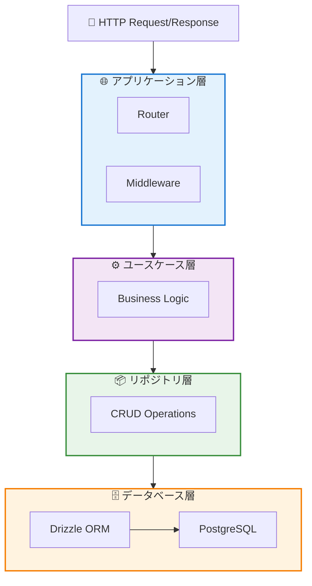

# Backend

## 概要

本ドキュメントでは、バックエンド API (`apps/main-api`) の技術スタック、ディレクトリ構成、アーキテクチャ、データベース管理について説明します。

バックエンドは **Hono.js** をベースに、**レイヤードアーキテクチャ** を採用しています。型安全性とメンテナンス性を重視した設計になっています。

## 技術スタック

### バックエンド (`apps/main-api`)

| カテゴリ           | 技術                              | 用途                              |
| ------------------ | --------------------------------- | --------------------------------- |
| フレームワーク     | Hono.js                           | Web API フレームワーク            |
| ランタイム         | Node.js + tsx                     | TypeScript 実行環境               |
| ORM                | Drizzle ORM                       | データベース操作                  |
| データベース       | PostgreSQL 17                     | リレーショナルデータベース        |
| キャッシュ         | Redis 7.0                         | セッション管理、キャッシュ        |
| バリデーション     | Valibot + @hono/valibot-validator | リクエスト検証                    |
| エラーハンドリング | neverthrow                        | Result 型による型安全なエラー処理 |
| ロギング           | pino                              | 構造化ログ                        |
| テスト             | Vitest                            | ユニットテスト                    |

## ディレクトリ構成

### バックエンド (レイヤードアーキテクチャ)

- **apps/**: アプリケーション層（ルーティング、ミドルウェア）
- **usecases/**: ユースケース層（ビジネスロジック）
- **repositories/**: リポジトリ層（データアクセス）
- **libs/**: 共通ライブラリ（設定、ユーティリティ）

## 主要コマンド

### バックエンド (`apps/main-api`)

| コマンド     | 説明                          |
| ------------ | ----------------------------- |
| `pnpm dev`   | 開発サーバー起動（tsx watch） |
| `pnpm build` | TypeScript をビルド           |
| `pnpm test`  | テスト実行                    |

## データベース管理

### Drizzle ORM コマンド

バックエンド (`apps/main-api`) で以下のコマンドを実行します。

| コマンド                  | 説明                                            |
| ------------------------- | ----------------------------------------------- |
| `pnpm drizzle:generate`   | スキーマから SQL マイグレーションを生成         |
| `pnpm drizzle:migrate`    | マイグレーションを実行                          |
| `pnpm drizzle:studio`     | Drizzle Studio を起動（GUI でデータ確認・編集） |
| `pnpm drizzle:seed`       | シードデータを投入                              |
| `pnpm drizzle:reset`      | データベースをリセット                          |
| `pnpm drizzle:introspect` | 既存の DB からスキーマを逆生成                  |

### Database スキーマの変更手順

1. **スキーマを編集**

   - `apps/main-api/drizzle/base/` でテーブル定義を変更

2. **マイグレーションファイルを生成**

   ```bash
   cd apps/main-api
   pnpm drizzle:generate
   ```

3. **マイグレーションを適用**

   ```bash
   pnpm drizzle:migrate
   ```

4. **型定義を更新**
   - TypeScript の型は自動的に更新されます

### Drizzle Studio の使い方

データベースの中身を GUI で確認・編集できます。

```bash
cd apps/main-api
pnpm drizzle:studio
```

ブラウザで https://local.drizzle.studio が開きます。

## バックエンドのアーキテクチャ

**レイヤードアーキテクチャ** を採用しています。



### 各層の役割

- **アプリケーション層**: ルーティング、バリデーション、認証
- **ユースケース層**: ビジネスロジックの実装
- **リポジトリ層**: データベースの CRUD 操作
- **データベース層**: データの永続化

### エラーハンドリング

**neverthrow** を使った Result 型によるエラーハンドリングを採用しています。

```typescript
// 成功の場合
return ok(data);

// エラーの場合
return err(new Error('エラーメッセージ'));
```

### Repository の型定義

クリーンアーキテクチャでは、Repository の型（Interface）を定義した後、実装（RepositoryImplement）を行うのが原則です。しかし、開発・保守コストを考慮する必要があること、また出力データの検証が `packages/domains` と役割が重複してしまうため、本プロジェクトでは `ReturnType` を利用した型推論を採用しています。

#### 実装例

**Repository の実装** (`apps/main-api/src/repositories/document.repository.ts`)

```typescript
import type { Client } from '@db/index.js';
import { documentDbSchema } from '@db/schema.js';
import { eq } from 'drizzle-orm';

export const documentRepository = (db: Client) => {
	return {
		/**
		 * ドキュメント一覧を取得
		 */
		findDocuments: async ({ where, orderBy, limit, offset } = {}) => {
			const query = db
				.select()
				.from(documentDbSchema)
				.where(where)
				.limit(limit)
				.offset(offset);

			return await query;
		},

		/**
		 * ドキュメントをIDで取得
		 */
		findDocumentById: async (id: string) => {
			return await db
				.select()
				.from(documentDbSchema)
				.where(eq(documentDbSchema.id, id))
				.then((rows) => rows[0]);
		}
	};
};

// ReturnTypeを使って型を推論
export type DocumentRepository = ReturnType<typeof documentRepository>;
```

**UseCase での利用** (`apps/main-api/src/usecases/document/find-documents.usecase.ts`)

```typescript
import type { DocumentRepository } from '@/repositories/document.repository.js';

/**
 * ドキュメント一覧を取得するユースケース
 */
export const findDocumentsUseCase =
	(repository: DocumentRepository) => async (params: FindDocumentsParams) => {
		try {
			// Repositoryの戻り値の型は自動的に推論される
			const documents = await repository.findDocuments({
				where: params.title
					? like(documentDbSchema.title, `%${params.title}%`)
					: undefined,
				orderBy: params.sortBy
					? [{ field: params.sortBy, order: params.orderBy }]
					: undefined,
				limit: params.limit,
				offset: params.offset
			});

			return ok({ data: documents });
		} catch (_error) {
			return err(
				new HTTPException(500, { message: 'ドキュメントの取得に失敗しました' })
			);
		}
	};
```

このアプローチにより、以下のメリットが得られます:

- **型安全性**: Repository の実装から自動的に型が推論される
- **開発効率**: Interface と実装を別々に定義する必要がなく、保守コストが削減される
- **重複排除**: `packages/domains` での検証と重複せず、責務が明確になる
