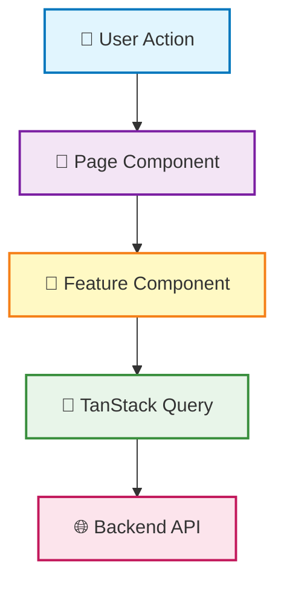

# Frontend

## 概要

本ドキュメントでは、フロントエンドアプリケーション (`apps/front`) の技術スタック、ディレクトリ構成、アーキテクチャについて説明します。

フロントエンドは **React 19** と **Vite** をベースに、**Feature Sliced Design** アーキテクチャを採用しています。型安全性を重視し、モダンな開発体験を提供します。

## 技術スタック

### フロントエンド (`apps/front`)

| カテゴリ          | 技術                   | 用途                   |
| ----------------- | ---------------------- | ---------------------- |
| フレームワーク    | React 19 + Vite        | UI 構築とビルドツール  |
| ルーティング      | TanStack Router        | 型安全なルーティング   |
| UI コンポーネント | Chakra UI v3 (Ark UI)  | デザインシステム       |
| 状態管理          | TanStack Query         | サーバー状態管理       |
| テーブル          | TanStack Table         | データテーブル構築     |
| フォーム          | React Hook Form        | フォーム管理           |
| バリデーション    | Valibot                | スキーマバリデーション |
| 国際化            | i18next, react-i18next | 多言語対応             |
| ユーティリティ    | es-toolkit, date-fns   | 汎用関数、日付処理     |
| テスト            | Vitest                 | ユニットテスト         |
| Storybook         | Storybook              | コンポーネント開発環境 |

## ディレクトリ構成

### フロントエンド (Feature Sliced Design)

- **app/**: アプリケーション全体の設定、ルート定義
- **feature/**: 機能単位で独立したコンポーネント（例: ドキュメント作成フォーム）
- **page/**: URL パスに対応するページコンポーネント
- **widget/**: 複数のページで使われる大きなコンポーネント（例: ヘッダー、サイドバー）
- **shared/**: プロジェクト全体で共有されるコード（API クライアント、UI コンポーネント、ユーティリティ）

### フロントエンドのアーキテクチャ

**Feature Sliced Design** に基づいた構成です。

#### データフロー

#### 状態管理の方針

- **サーバー状態**: TanStack Query で管理
- **フォーム状態**: React Hook Form で管理
- **UI 状態**: React の useState/useReducer で管理
- **グローバル状態**: 必要最小限に抑える
